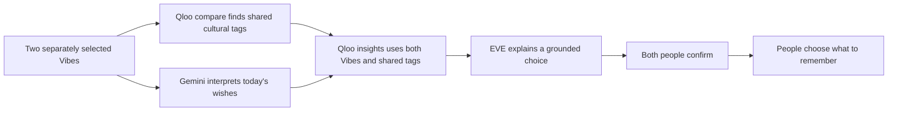

# EverVibe

**From me, to us.**

EverVibe turns cultural interests into things two people can do, discuss and remember together. EVE helps them express what matters; Qloo supplies the cultural discoveries behind a shared plan. People choose what to say and whether to go.

## Explore

- **[Try the live demo](https://evervibe.zesty-mesa-1831.chatgpt.site/try?lang=en)** — start with two sample tastes or bring your own.
- **[Follow four stories](https://evervibe.zesty-mesa-1831.chatgpt.site/stories?lang=en)** — explore the fictional relationships and the story features.

- **Four stories** — `/stories.html?lang=en`: four fictional couples in Tokyo, New York, London and Wellington. Each story explores a different moment: discovery, connection, repair or lasting companionship.
- **Try your own Vibe** — `/try.html?lang=en`: choose **Try two different tastes** for a quick start, or search for films, artists or books yourself. Share the two Vibes, see their common cultural themes from Qloo, and make a plan with EVE. You can play both sides; no other person needs to be online.
- [User guide](USER_GUIDE.md) — getting started, the four stories and the three conversation spaces.

The first visit starts in English. English and Simplified Chinese interface and authored story text are available from Settings; the selected language is remembered. Language changes preserve the active session. Typed and already generated messages stay in their original language; new EVE requests use the selected language. Official titles and addresses remain recognizable. Other system languages are not yet translated.

## How culture changes the result



Qloo is called with resolved cultural entity IDs and bounded filters. Its candidates constrain the places, films and destinations EVE can propose. A date or activity is usually represented by a Qloo `place`. The demo does not claim to integrate every Qloo domain, predict romantic compatibility, or match real people.

In the visitor experience, `/v2/analysis/compare` receives each person's selected entity IDs separately. Its shared cultural tags appear in **A little common ground** and become `signal.interests.tags` in `/v2/insights`, alongside both sets of entity IDs. EVE's explanation is prompted to reference each person's selected work or artist and a returned shared theme. Private notes and chat are never sent to Qloo.

A live **Knives Out + Amélie / New York** comparison returned **Comedy, Stylized and Eccentric**. Adding those themes to the same place query changed five of the first six candidate IDs; Museum of the Moving Image appeared among the new candidates. This demonstrates an effect on this request, not a measured improvement in recommendation quality. [Read the comparison and its limits](docs/QLOO_COMPARISON.md), including an earlier unchanged-result control.

The four authored stories retain their existing entity-based planning path. The compare integration is currently in the visitor Try experience. Missing shared tags do not block plans; a compare outage is labeled and falls back to entity-based discovery. If the final explanation request has a transient Gemini failure, the verified Qloo candidates remain usable. A failure at the initial Gemini routing step still requires a retry.

## Run locally

Requires Node.js **22.13 or newer** and npm. Run these commands from the repository root:

```sh
npm run install:ci
npm run build
```

For live services, copy `.env.example` to `.env.local` and supply your own **server-side** Qloo and Gemini credentials. The default Qloo endpoint is the hackathon endpoint; an account must have access to it. Use a Gemini model available to your account that supports the Interactions API and structured responses.

Initialize the local public-catalog database **once for a fresh local database**:

```sh
node --import ./scripts/sites-env.mjs ./node_modules/wrangler/bin/wrangler.js d1 execute DB --local --config dist/server/wrangler.json --persist-to .wrangler/state --file drizzle/0000_motionless_post.sql
```

Then start the built Worker:

```sh
npm start -- --port 5173 --env-file .env.local
```

Open `http://127.0.0.1:5173/`. To inspect authored UI without credentials, omit `--env-file .env.local`; live requests will report that services are unavailable. `/api/status` reports configuration status without returning credentials.

## Development

```sh
npm run test:server
node node_modules/typescript/bin/tsc --noEmit
npm run build
```

Server tests use mocked providers and an in-memory database. They require no API credentials and do not incur provider charges. See [server/TESTING.md](server/TESTING.md) for the test setup.

## Source layout

| Path | Purpose |
| --- | --- |
| `app/` | Landing page and Worker API route |
| `public/story-*.js`, `public/ui-messages.js` | Four stories, separate chat spaces, shared state and bilingual copy |
| `public/try-*` | Visitor Vibes, fictional black box, shared planning and language settings |
| `server/source/` | Qloo, Gemini, planning, proactive EVE and provider validation |
| `server/catalog-store.mjs` | D1 cache containing public Qloo catalog facts only |
| `server/generated/` | Rebuilt service bundle; edit `server/source/` instead |
| `db/`, `drizzle/` | Catalog schema and versioned migration |
| `public/assets/`, `public/vendor/` | Included portraits, tree model and licensed browser modules |

`npm run build` regenerates the service bundle and builds the Worker and browser assets. The supplied Sites build integration and `.openai/hosting.json` describe this project's hosting and storage. A fork must use its own Site identity and runtime secrets before deploying. Credentials and local service data are excluded from Git.

## What the prototype does and does not do

- Every story character, portrait and introduction is fictional. Try's black box always offers the clearly labeled demo character Anya; a real catalog lookup supplies her sample film interest. This is not a dating network.
- `Share my Vibe` and `Receive EVE suggestions` are independent controls. Shared EVE needs both people's participation. Later story presets start with sharing enabled as part of the fiction.
- With both people's participation, private EVE can turn the speaker's expressed small wish into a suggestion in the partner's EVE window. It does not send a human message or copy a private transcript into shared planning. Explicitly private, sensitive or surprise details are filtered. This is a demo interaction, not a guarantee that a model will interpret every situation correctly.
- Single-browser role switching demonstrates the experience. It is **not** separate-user authentication or production access control.
- Session chats, memories and progress remain in page memory and reset on reload. Only the selected language is saved on the device. D1 stores public cultural titles, IDs and expiry times, not relationship records. External API providers and hosting have their own processing and retention terms.
- EVE's proactive events run inside the open app. It does not observe real life, send phone notifications, make bookings or message people elsewhere. People enter real-life memories themselves.
- Returned venues are not confirmations of opening hours, accessibility, availability or a scheduled performance. The app has not been tested for relationship outcomes with real couples.
- Request/concurrency protection is transient per Worker instance. No daily or total API spending cap is imposed by this app; provider account controls are separate. Expired planning context prompts a fresh request.

## Where we want to go

Our long-term vision is for EVE to become a global emotional companion and everyday-life assistant, helping care take shape in the real world. Culture gives each shared moment its meaning; authorized connections to reservations, food delivery, travel and other services could help make it happen. We would build this gradually, with revocable permissions, clear costs and service-confirmed outcomes. These integrations and broader language coverage are future work; this demo establishes the first cultural-planning and relationship-interaction workflow.

Food belongs in that cultural vision. Qloo documents [restaurant discovery](https://github.com/qloo/docs-public/blob/main/recipes/recipes.md) and [cuisine signals](https://github.com/qloo/docs-public/blob/main/reference/taste-analysis.md). Completing an order or reservation requires a separate service integration; a recommendation is not a booking confirmation.

## License and assets

Project-authored source and documentation are under [MIT](LICENSE). Generated images, the paid Tripo model, dependencies, provider data and any video audio have separate provenance and terms: [ASSETS.md](ASSETS.md) and [THIRD_PARTY_NOTICES.md](THIRD_PARTY_NOTICES.md).

No music is bundled in the app. Private notes, key screenshots, billing records, generation receipts, credentials and local logs are excluded from the release.
