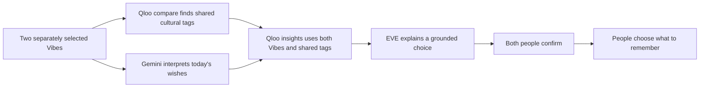

# EverVibe

**From me, to us.**

EverVibe turns cultural interests into things two people can do, discuss and remember together. EVE helps them express what matters; Qloo supplies the cultural discoveries behind a shared plan. People choose what to say and whether to go.

## Explore

- **[Try the interactive app](https://evervibe.zesty-mesa-1831.chatgpt.site/try?lang=en)** — open directly in private EVE chat with a rotatable black box.
- **[Explore four stories](https://evervibe.zesty-mesa-1831.chatgpt.site/stories?lang=en)** — follow four authored fictional relationships through the same app features.

- **Interactive app** — `/try?lang=en`: a short skippable welcome leads to private EVE chat. Write freely, prepare a reviewable Vibe draft from your own messages, or choose a device-local photo. **My Vibe** contains your introduction and optional explicit partner criteria. The full-screen rotatable black box introduces one of eight clearly fictional adults. When cultural discovery is enabled and interests are selected, Qloo compare ranks eligible introductions by returned cultural themes. Missing criteria remain exploratory; this is not a romantic compatibility score. **Say hello** opens the selected character’s simulated direct chat. Sharing, planning, memories and agreements remain separate for each connection. Automatic replies never approve either person’s choices.
- **Four stories** — `/stories?lang=en`: four fictional couples in Tokyo, New York, London and Wellington. Each story explores a different moment: discovery, connection, repair or lasting companionship. This is a separate entry point with its own session progress.
- [User guide](USER_GUIDE.md) — getting started, the four stories and the three conversation spaces.

For a sample planning setup, open **Settings** and select **Try two different tastes** while both Vibes are empty. It fills sample interests without changing the visitor's location or enabling sharing. Otherwise, search for films, artists or books and choose actual catalog results. Opening the black box remains a fictional introduction. With discovery enabled, Qloo cultural comparisons influence its ordering, as well as common themes and shared plans. Without selected tastes or discovery permission, introductions are explicitly exploratory.

The first visit starts in English. English and Simplified Chinese interface and authored story text are available from Settings; the selected language is remembered. Language changes preserve the active session. Typed and already generated messages stay in their original language; new EVE requests use the selected language. Official titles and addresses remain recognizable. Other system languages are not yet translated.

## How culture changes the result



Qloo is called with resolved cultural entity IDs and bounded filters. Its candidates constrain the places, films and destinations EVE can propose. A date or activity is usually represented by a Qloo `place`. The demo does not claim to integrate every Qloo domain, predict romantic compatibility, or match real people.

In both visitor and story planning, `/v2/analysis/compare` receives each person's selected entity IDs separately. Its shared cultural tags appear in the common-ground card and become `signal.interests.tags` in `/v2/insights`, alongside both sets of entity IDs. EVE's explanation is prompted to reference each person's selected work or artist and a returned shared theme. Private notes and chat are never sent to Qloo.

A live **Knives Out + Amélie / New York** comparison returned **Comedy, Stylized and Eccentric**. Adding those themes to the same place query changed five of the first six candidate IDs; Museum of the Moving Image appeared among the new candidates. This demonstrates an effect on this request, not a measured improvement in recommendation quality. [Read the comparison and its limits](docs/QLOO_COMPARISON.md), including an earlier unchanged-result control.

Missing shared tags do not block plans; a compare outage is labeled and falls back to entity-based discovery. In Try, if the final explanation request has a transient Gemini failure, the verified Qloo candidates remain usable. A failure at the initial Gemini routing step still requires a retry.

The interactive app uses the visitor's location after **Use my location** and browser permission, or accepts a city and country entered in Settings. It is not limited to the four story cities. Approximate device coordinates are session-only Qloo search inputs; they are not sent to Gemini. Missing permission or an unresolved city prompts a correction rather than a silent Tokyo fallback. The four authored stories remain set in Tokyo, New York, London and Wellington.

## Run locally

Requires Node.js **22.13 or newer** and npm. Run these commands from the repository root:

```sh
npm run install:ci
npm run build
```

For live services, copy `.env.example` to `.env.local` and supply your own **server-side** Qloo and Gemini credentials. The default Qloo endpoint is the hackathon endpoint; an account must have access to it. Use a Gemini model available to your account that supports the Interactions API and structured responses.

Initialize the local public-catalog database **once for a fresh local database**:

```sh
node --import ./scripts/sites-env.mjs ./node_modules/wrangler/bin/wrangler.js d1 execute DB --local --config dist/server/wrangler.json --persist-to .wrangler/state --file drizzle/0000_motionless_post.sql
```

Then start the built Worker:

```sh
npm start -- --port 5173 --env-file .env.local
```

Open `http://127.0.0.1:5173/`. To inspect authored UI without credentials, omit `--env-file .env.local`; live requests will report that services are unavailable. `/api/status` reports configuration status without returning credentials.

## Development

```sh
npm run test:server
node node_modules/typescript/bin/tsc --noEmit
npm run build
```

Server tests use mocked providers and an in-memory database. They require no API credentials and do not incur provider charges. The current suite contains 174 checks. See [server/TESTING.md](server/TESTING.md) for the test setup and [the recommendation repair record](docs/RECOMMENDATION_FIX.md) for the NYC regression and recovery behavior.

## Source layout

| Path | Purpose |
| --- | --- |
| `app/` | Landing page and Worker API route |
| `public/story-*.js`, `public/ui-messages.js` | Four stories, separate chat spaces, shared state and bilingual copy |
| `public/try-*` | Visitor Vibes, fictional black box, shared planning and language settings |
| `server/source/` | Qloo, Gemini, planning, proactive EVE and provider validation |
| `server/catalog-store.mjs` | D1 cache containing public Qloo catalog facts only |
| `server/generated/` | Rebuilt service bundle; edit `server/source/` instead |
| `db/`, `drizzle/` | Catalog schema and versioned migration |
| `public/assets/`, `public/vendor/` | Included portraits, tree model and licensed browser modules |

`npm run build` regenerates the service bundle and builds the Worker and browser assets. The supplied Sites build integration and `.openai/hosting.json` describe this project's hosting and storage. A fork must use its own Site identity and runtime secrets before deploying. Credentials and local service data are excluded from Git.

## What the prototype does and does not do

- Every story character, portrait and introduction is fictional. Try's black box always offers the clearly labeled demo character Anya; a real catalog lookup supplies her sample film interest. This is not a dating network.
- `Share my Vibe` and `Receive EVE suggestions` are independent controls. Shared EVE needs both people's participation. Later story presets start with sharing enabled as part of the fiction.
- In the authored stories, with both people's participation, private EVE can turn the speaker's expressed small wish into a suggestion in the partner's EVE window. It does not send a human message or copy a private transcript into shared planning. Explicitly private, sensitive or surprise details are filtered. This is a demo interaction, not a guarantee that a model will interpret every situation correctly.
- Single-browser role switching demonstrates the experience. It is **not** separate-user authentication or production access control.
- Try keeps each person's private EVE thread separate from direct chat and shared planning. Its automatic sample companion uses model-generated responses labeled as simulated in direct chat and Make plans. The visitor can disable that behavior and enter both roles manually. A simulated reply cannot change sharing or confirm a plan, memory or agreement; those actions still require the visitor to review both roles. `/api/try/private` receives only the current person's history and includes the other profile only when that person has enabled sharing. Private transcripts are not sent to Qloo, shared planning or memories. Try includes jointly confirmed memories, the interactive growing tree, care rewards, manual agreements and event-based EVE check-ins. Memory excerpts can include the sample companion's simulated shared dialogue, so they are demo records rather than proof of real events. The authored stories additionally demonstrate private-wish delivery; that automatic delivery is not enabled for arbitrary visitor text.
- The interactive app saves chats, selected demo connections, sharing choices, memories, garden resources, profile and drafts in this browser’s local storage. Reset this device removes this save after confirmation. Browser-data deletion or private browsing may remove it; it is not an account or cross-device sync. Precise location is not persisted. Restored planning results require a fresh planning session. D1 stores public cultural titles, IDs and expiry times, not relationship records. External API providers and hosting have their own processing and retention terms.
- EVE's proactive events run inside the open app. It does not observe real life, send phone notifications, make bookings or message people elsewhere. People enter real-life memories themselves.
- Returned venues are not confirmations of opening hours, accessibility, availability or a scheduled performance. The app has not been tested for relationship outcomes with real couples.
- Request/concurrency protection is transient per Worker instance. No daily or total API spending cap is imposed by this app; provider account controls are separate. Expired planning context prompts a fresh request.

## Where we want to go

Our long-term vision is for EVE to become a global emotional companion and everyday-life assistant, helping care take shape in the real world. Culture gives each shared moment its meaning; authorized connections to reservations, food delivery, travel and other services could help make it happen. We would build this gradually, with revocable permissions, clear costs and service-confirmed outcomes. These integrations and broader language coverage are future work; this demo establishes the first cultural-planning and relationship-interaction workflow.

Food belongs in that cultural vision. Qloo documents [restaurant discovery](https://github.com/qloo/docs-public/blob/main/recipes/recipes.md) and [cuisine signals](https://github.com/qloo/docs-public/blob/main/reference/taste-analysis.md). Completing an order or reservation requires a separate service integration; a recommendation is not a booking confirmation.

## License and assets

Project-authored source and documentation are under [MIT](LICENSE). Generated images, the paid Tripo model, dependencies, provider data and any video audio have separate provenance and terms: [ASSETS.md](ASSETS.md) and [THIRD_PARTY_NOTICES.md](THIRD_PARTY_NOTICES.md).

No music is bundled in the app. Private notes, key screenshots, billing records, generation receipts, credentials and local logs are excluded from the release.

## A bridge between different tastes

Try now requests Qloo Insights with both sets of public entity IDs and `feature.explainability=true`. A new film qualifies only when Qloo returns contributions from both Vibes (at least 0.1 per side); selected works are excluded. We order qualified results by balanced input contributions. This is an application selection rule over provider evidence, not a romantic compatibility score or a guarantee of individual enjoyment. Missing evidence is never replaced with invented themes. The bridge can be considered and confirmed by both demo perspectives in Make plans.

## Development provenance and feedback

Development began in a local working folder. The public repository was introduced later as a clean product-source snapshot, excluding credentials, personal notes and internal preparation files. Its initial commit count therefore does not represent the full development history; subsequent fixes are recorded as normal commits. We do not backdate or manufacture commits. Tests and live checks are engineering validation, not independent user research. The creator has supplied hands-on feedback, but no independent participant study or relationship-outcome validation has been completed.

## Private discovery boundaries

Eight authored adult profiles use 23 verified public Qloo catalog records across films, books and artists. Personality-type labels are not shipped in the client and never enter ranking. Explicit age and gender preferences are checked in both directions. Unknown age, gender or location cannot become a verified mutual fit. Demo candidates have no verified physical location. Cultural ordering counts distinct themes returned by Qloo; it is an explainable prototype heuristic, not a calibrated score or prediction of attraction.

Photos are decoded and previewed locally with object URLs; they are not uploaded or analysed by EVE. Profile drafts use only the visitor’s own submitted chat messages, exclude inferred sensitive traits, and require review before use. No public feed, likes, comments or real-user discovery database exists. Relationship records and photos remain in the open tab; only language preference persists. A production service would need authenticated accounts, server-enforced bilateral discovery rules, private media storage with short-lived access, revocation/deletion and relationship-scoped access controls before accepting real users.


## Updating your Vibe

Talk naturally with EVE, then choose Vibe → Draft my Vibe from our chat. Review the introduction, partner wishes and recognized favourites before applying. Confirmed profile facts and your own recent EVE messages help EVE remember you across your separate relationship spaces; other people’s private transcripts are never merged. Latest explicit corrections take precedence in the draft. Manual favourites remain optional under Add or change a favourite.

Discovery filters explicit age/gender criteria in both directions, then prioritizes a small, documented set of stated lifestyle wishes (quiet time, spontaneity, live music, outdoors, art or conversation), then ranks returned Qloo shared themes. Lifestyle matching is a transparent prototype rule, not unrestricted semantic understanding or a romantic compatibility score. Unrecognized wishes remain in your profile but may not affect ranking. Updated cultural favourites change the IDs sent to Qloo for subsequent recommendations. Existing conversations remain available in People.


## License scope

The MIT grant covers project-authored source code and documentation. Generated media and third-party works retain the terms stated in ASSETS.md and THIRD_PARTY_NOTICES.md. Provider services, catalogs and trademarks are not relicensed by this file.
